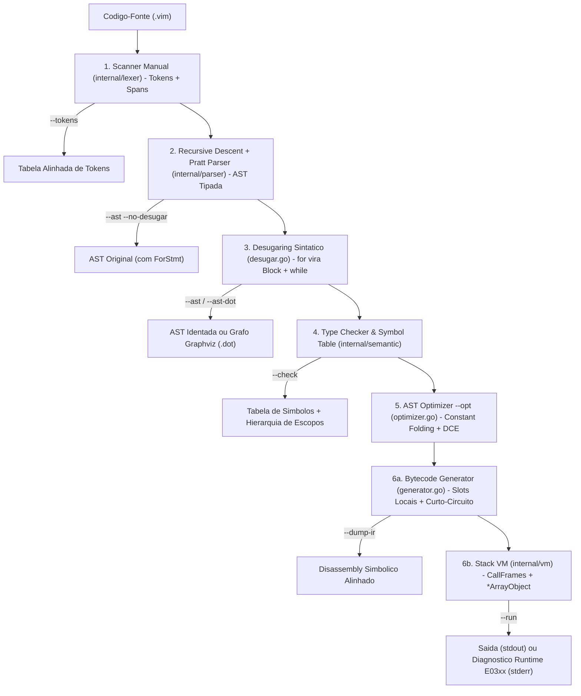

# Compilador vim (`vim`)

Compilador completo *from scratch* e Máquina Virtual de Pilha (**Stack VM**) para a linguagem imperativa estaticamente tipada **vim** (`.vim`), desenvolvido em **Go** puro (*standard library only*, zero dependências externas).

O projeto foi arquitetado com foco em **modularidade estrita entre fases**, **rastreamento exato de localização léxica (`Span`)**, **diagnósticos visuais estilo Rust/Clang** (com acumulação de erros e recuperação *Panic Mode*) e **inspeção transparente de cada camada** via linha de comando.

---

## Sumário

1. [Arquitetura do Compilador vim](#1-arquitetura-do-compilador-vim)
2. [Gramática Formal Completa (EBNF) e Pratt Parser](#2-gramática-formal-completa-ebnf-e-pratt-parser)
3. [Sistema de Tipos, Escopo e Semântica](#3-sistema-de-tipos-escopo-e-semântica)
4. [Arquitetura da Stack VM e Conjunto de Instruções (ISA)](#4-arquitetura-da-stack-vm-e-conjunto-de-instruções-isa)
5. [Catálogo Completo de Diagnósticos (`E0001` a `E0304`)](#5-catálogo-completo-de-diagnósticos-e0001-a-e0304)
6. [Compilação, Testes Automatizados e Uso da CLI](#6-compilação-testes-automatizados-e-uso-da-cli)
7. [Roteiro de Apresentação ao Vivo para a Banca (5 a 10 minutos)](#7-roteiro-de-apresentação-ao-vivo-para-a-banca-5-a-10-minutos)

---

## 1. Arquitetura do Compilador vim

### 1.1 Pipeline Completo de 6 Etapas

O código-fonte `.vim` atravessa seis estágios desacoplados e sequenciais. Qualquer erro estático (léxico, sintático ou semântico) é acumulado no coletor central `diagnostics.Bag` e interrompe a transição para geração de código antes da execução.



Visão linear resumida do pipeline:

```text
Scanner -> Recursive Descent + Pratt Parser -> Desugaring (for->while) -> Type Checker & Symbol Table -> AST Optimizer -> Bytecode Generator & Stack VM
```

### 1.2 Estrutura de Diretórios e Responsabilidades

Todos os subsistemas internos seguem a convenção idiomática `internal/` do Go, impedindo acoplamento indevido externo e mantendo fronteiras limpas entre fases:

```text
compilador/
├── cmd/
│   └── vim/
│       └── main.go                  # Ponto de entrada mínimo do executável `vim`
├── internal/
│   ├── cli/                         # Orquestração das flags (--tokens, --ast, --check, --dump-ir, --run, --opt, --stats)
│   │   ├── cli.go                   # Pipeline de execução, formatação de métricas e códigos de saída
│   │   ├── hrtime_windows.go        # Cronômetro de alta resolução via QueryPerformanceCounter (Windows)
│   │   └── hrtime_other.go          # Cronômetro padrão para sistemas POSIX (Linux/macOS)
│   ├── diagnostics/                 # Motor transversal de localização e relato visual de erros
│   │   ├── span.go                  # Estruturas Position e Span [StartOffset..EndOffset) com Merge()
│   │   ├── diagnostic.go            # Severidades, estrutura Diagnostic e coletor acumulativo Bag
│   │   └── reporter.go              # Renderizador visual estilo Rust/Clang com expansão de TAB e sublinhado ^^^
│   ├── lexer/                       # Fase 1: Analisador Léxico manual
│   │   ├── token.go                 # Tipos de token, tabela hash O(1) de palavras-chave e estrutura Token
│   │   └── scanner.go               # Autômato manual UTF-8, strings escapadas, comentários /* ... */ aninhados
│   ├── parser/                      # Fase 2: Analisador Sintático, AST, Desaçucaramento e Exportadores
│   │   ├── ast.go                   # Nós fortemente tipados da AST (Declarações, Comandos, Expressões, Tipos)
│   │   ├── pratt.go                 # Pratt Parser (Top-Down Operator Precedence) com 8 níveis de Binding Power
│   │   ├── parser.go                # Descida recursiva, validação de L-Values, sincronização Panic Mode
│   │   ├── desugar.go               # Reescrita de `for` em bloco léxico `{ init; while (cond) { body; post; } }`
│   │   └── printer.go               # Serializadores da AST em árvore textual (`--ast`) e Graphviz (`--ast-dot`)
│   ├── semantic/                    # Fase 3: Analisador Semântico Estático
│   │   ├── types.go                 # Sistema de tipos (`int`, `bool`, `string`, `void`, `[]T`, `fn`, `TypeError`)
│   │   ├── symbols.go               # Tabela de símbolos e árvore de escopos léxicos encadeados (`Scope`)
│   │   ├── checker.go               # Checador em 2 passadas, inferência de `[]`, imutabilidade `const`, retorno garantido
│   │   └── report.go                # Relatório didático da tabela de símbolos e árvore de escopos (`--check`)
│   ├── ir/                          # Fase 4a: Representação Intermediária (Bytecode) e Otimizador
│   │   ├── opcode.go                # Definição dos 34 OpCodes da ISA e IDs das 5 funções intrínsecas
│   │   ├── chunk.go                 # Pool deduplicado de constantes, instruções com Span, FunctionChunk e Module
│   │   ├── optimizer.go             # Passe `--opt`: Constant Folding seguro, propagação de const e DCE
│   │   ├── generator.go             # Compilador AST -> Bytecode com pilha léxica de slots locais e curto-circuito
│   │   └── disassembler.go          # Desassemblador simbólico alinhado para `--dump-ir`
│   └── vm/                          # Fase 4b: Máquina Virtual de Pilha (Stack VM)
│       ├── value.go                 # União discriminada Value e estrutura referenciada *ArrayObject
│       ├── frame.go                 # Quadro de ativação CallFrame (função alvo, IP e BaseSlot)
│       └── vm.go                    # Ciclo Fetch-Decode-Execute, intrínsecos de I/O e erros visuais E0301..E0304
├── exemplos/
│   ├── validos/                     # 5 programas canônicos demonstrando recursão, laços, escopos, arrays e otimização
│   └── invalidos/                   # 8 casos cobrindo erros léxicos, sintáticos, semânticos e de execução (runtime)
├── examples_test.go                 # Suíte de integração ponta a ponta (testes golden, equivalência --opt e 4 camadas de erro)
└── go.mod                           # Módulo Go 1.23+ sem dependências externas
```

---

## 2. Gramática Formal Completa (EBNF) e Pratt Parser

### 2.1 Especificação EBNF Atualizada

Funções (`fn`) são estritamente **top-level** (proibidas dentro de blocos ou de outras funções com `E0101`), mantendo o modelo de execução em máquina de pilha livre de *closures* implícitas. Listas de parâmetros, argumentos e literais de array aceitam **vírgula opcional ao final** (*trailing comma*).

```ebnf
Program        ::= TopLevelDecl* EOF ;

TopLevelDecl   ::= FnDecl
                 | VarDecl
                 | ConstDecl
                 | Statement ;

(* Declarações Top-Level e de Escopo *)
FnDecl         ::= "fn" IDENT "(" ParamList? ")" ( "->" Type )? Block ;
ParamList      ::= Param ( "," Param )* ","? ;
Param          ::= IDENT ":" Type ;

VarDecl        ::= "let" IDENT ":" Type "=" Expr ";" ;
ConstDecl      ::= "const" IDENT ":" Type "=" Expr ";" ;

(* Anotações de Tipo Estático *)
Type           ::= "int"
                 | "bool"
                 | "string"
                 | "void"
                 | "[" "]" Type ;

(* Comandos — fn aninhada é explicitamente proibida dentro de Block *)
Block          ::= "{" BlockItem* "}" ;
BlockItem      ::= VarDecl
                 | ConstDecl
                 | Statement ;

Statement      ::= Block
                 | IfStmt
                 | WhileStmt
                 | ForStmt
                 | ReturnStmt
                 | AssignOrExprStmt ;

IfStmt         ::= "if" "(" Expr ")" Block ( "else" ( IfStmt | Block ) )? ;
WhileStmt      ::= "while" "(" Expr ")" Block ;
ForStmt        ::= "for" "(" ForInit? ";" Expr? ";" ForPost? ")" Block ;
ForInit        ::= VarDeclNoSemi | AssignNoSemi | Expr ;
ForPost        ::= AssignNoSemi | Expr ;
VarDeclNoSemi  ::= "let" IDENT ":" Type "=" Expr ;
AssignNoSemi   ::= LValue "=" Expr ;

ReturnStmt     ::= "return" Expr? ";" ;

(* Resolução determinística de L-Value vs Expressão *)
AssignOrExprStmt ::= Expr ( "=" Expr )? ";" ;
LValue           ::= IDENT ( "[" Expr "]" )* ;

(* Expressões governadas pelo Pratt Parser *)
Expr           ::= OrExpr ;
OrExpr         ::= AndExpr ( "||" AndExpr )* ;
AndExpr        ::= EqualityExpr ( "&&" EqualityExpr )* ;
EqualityExpr   ::= RelExpr ( ( "==" | "!=" ) RelExpr )* ;
RelExpr        ::= AddExpr ( ( "<" | "<=" | ">" | ">=" ) AddExpr )* ;
AddExpr        ::= MulExpr ( ( "+" | "-" ) MulExpr )* ;
MulExpr        ::= UnaryExpr ( ( "*" | "/" | "%" ) UnaryExpr )* ;
UnaryExpr      ::= ( "!" | "-" ) UnaryExpr
                 | PostfixExpr ;
PostfixExpr    ::= PrimaryExpr ( CallSuffix | IndexSuffix )* ;
CallSuffix     ::= "(" ArgList? ")" ;
IndexSuffix    ::= "[" Expr "]" ;
ArgList        ::= Expr ( "," Expr )* ","? ;

PrimaryExpr    ::= INT_LIT
                 | STRING_LIT
                 | "true"
                 | "false"
                 | IDENT
                 | "[" ArgList? "]"
                 | "(" Expr ")" ;

(* Gramática Léxica *)
IDENT          ::= ( LETTER | "_" ) ( LETTER | DIGIT | "_" )* ;
INT_LIT        ::= DIGIT+ ;                   (* Inteiro de 64 bits com sinal: -9223372036854775808 .. 9223372036854775807 *)
STRING_LIT     ::= '"' ( ESCAPE | ~["\r\n\\] )* '"' ;
ESCAPE         ::= "\" ( "n" | "t" | "r" | "\" | '"' | "0" ) ;
LINE_COMMENT   ::= "//" ~[\n]* ;
BLOCK_COMMENT  ::= "/*" ( BLOCK_COMMENT | . )* "*/" ;   (* Suporte completo a aninhamento *)
```

### 2.2 Níveis de Precedência e Binding Power (Pratt Parser)

O analisador de expressões em `internal/parser/pratt.go` utiliza **Top-Down Operator Precedence (Pratt Parsing)** com consulta `O(1)` de poder de ligação (*Binding Power*):

| Nível (BP) | Constante Interna | Operadores | Categoria | Associatividade | Avaliação |
| :---: | :--- | :--- | :--- | :---: | :--- |
| `8` | `precPostfix` | `f(...)`, `a[...]` | Chamada e Indexação | Esquerda | Sufixo iterativo encadeável (`mat[i][j]`) |
| `7` | `precUnary` | `!x`, `-x` | Negação lógica e aritmética | Direita (Prefixo) | Dobra `-9223372036854775808` em `math.MinInt64` |
| `6` | `precFactor` | `*`, `/`, `%` | Multiplicativos | Esquerda | Inteiros de 64 bits |
| `5` | `precTerm` | `+`, `-` | Aditivos e Concatenação | Esquerda | `int + int` ou `string + string` |
| `4` | `precComparison` | `<`, `<=`, `>`, `>=` | Relacionais | Esquerda | Apenas `int -> bool` |
| `3` | `precEquality` | `==`, `!=` | Igualdade | Esquerda | `int`, `bool` ou `string -> bool` |
| `2` | `precAnd` | `&&` | Conjunção Lógica | Esquerda | Curto-circuito booleano real |
| `1` | `precOr` | `\|\|` | Disjunção Lógica | Esquerda | Curto-circuito booleano real |

---

## 3. Sistema de Tipos, Escopo e Semântica

O pacote `internal/semantic` valida o programa após o desaçucaramento dos laços `for`:

1. **Tipagem Estática Estrita (Sem Coerções Implícitas)**:
   - Tipos primitivos: `int` (`int64`), `bool`, `string` e `void` (exclusivo para retorno de funções sem valor).
   - Tipos compostos recursivos: `[]T` (suportando vetores unidimensionais `[]int` e matrizes multidimensionais `[][]int`, `[]string`, etc.).
   - Variáveis, constantes, parâmetros e elementos de array do tipo `void` são estritamente proibidos (`E0204`).
   - Condições de `if` e `while` exigem estritamente o tipo `bool` (`E0203` — inteiros ou strings não são convertidos para booleano).

2. **Inferência Contextual de Literais de Array Vazio (`[]`)**:
   - Um literal vazio `[]` adota automaticamente o tipo esperado `[]T` quando aparece em:
     - Inicialização tipada (`let v: []int = [];`);
     - Atribuição a variável ou posição indexada de tipo conhecido (`v = [];`);
     - Argumento de função para parâmetro `[]T`;
     - Comando `return [];` em função com retorno `-> []T`;
     - Sub-elemento de array multidimensional (`let m: [][]int = [[], [1, 2]];`).
   - Caso `[]` apareça sem contexto dedutível (ex.: `len([])`), o compilador emite diagnóstico explícito `E0209`.

3. **Imutabilidade Profunda de `const` (`E0205`)**:
   - Símbolos declarados com `const` possuem `IsMutable = false`.
   - O analisador bloqueia **três formas de mutação**:
     1. Reatribuição escalar direta: `TAXA = 20;`;
     2. Mutação indexada em qualquer profundidade: `MATRIZ_CONST[0][1] = 99;` (inspecionando recursivamente a raiz da cadeia de `IndexExpr`);
     3. Mutação estrutural via intrínseco: `push(VETOR_CONST, 42);`.

4. **Tabela de Símbolos Encadeada e Resolução em Duas Passadas**:
   - Escopos léxicos formam uma árvore (`Scope.Parent` / `Scope.Children`).
   - Redeclarar um identificador no **mesmo** escopo gera `E0202`; declarar o mesmo nome em um bloco ou função interna realiza **sombreamento (*shadowing*)** seguro sem afetar a variável externa.
   - **Passada 1**: Coleta todas as assinaturas de funções top-level na tabela global antes de inspecionar os corpos, habilitando **recursão direta, recursão mútua** (`ehPar` <-> `ehImpar`) e chamadas adiantadas (*forward references*).
   - **Passada 2**: Valida declarações globais, comandos e corpos de funções com rastreamento de tipos em `ExprTypes`.

5. **Supressão de Erros em Cascata (`TypeError`)**:
   - Quando uma subexpressão falha na checagem de tipos, ela recebe o tipo sentinela interno `<erro>` (`TypeError`). Operações subsequentes envolvendo `<erro>` propagam o sentinela silenciosamente, evitando dezenas de mensagens falsas derivadas de um único erro raiz.

6. **Análise de Fluxo de Controle para Retorno Garantido (`guaranteesReturn`)**:
   - Toda função com retorno diferente de `void` deve encerrar com `return expr;` válido em **todos** os caminhos possíveis de execução (incluindo ambos os ramos `if` e `else` quando não há retorno final no corpo), caso contrário emite `E0208`.
   - O uso de `return` no escopo global fora de funções é rejeitado com `E0207`.

7. **Funções Intrínsecas Nativas**:

| Intrínseco | Assinatura Estática | Comportamento na VM |
| :--- | :--- | :--- |
| `print` | `fn(v1: any, ...) -> void` | Imprime 1+ valores (exceto `void`) separados por espaço seguidos de `\n`. |
| `read` | `fn() -> string` | Lê uma linha de `stdin` removendo `\r\n` final. |
| `read_int` | `fn() -> int` | Lê uma linha de `stdin` e converte para `int64` (ou dispara `E0304`). |
| `len` | `fn(x: string \| []T) -> int` | Retorna a contagem de runas UTF-8 da `string` ou o tamanho do array. |
| `push` | `fn(arr: []T, elem: T) -> void` | Anexa `elem` *in-place* ao final de `arr` (exige raiz mutável `let`). |

---

## 4. Arquitetura da Stack VM e Conjunto de Instruções (ISA)

### 4.1 Modelo de Execução (`internal/vm` e `internal/ir`)

- **Unidade Compilada (`ir.Module`)**: Contém a tabela de funções compiladas (`Functions []*FunctionChunk`) e o código de inicialização top-level (`Script *FunctionChunk`, exibido como `<script>`). Cada instrução carrega até dois operandos inteiros (`ArgA`, `ArgB`) e o `diagnostics.Span` exato da AST de origem.
- **Pilha de Quadros (`CallFrame`)**: Cada chamada empilha um `CallFrame{Fn, IP, BaseSlot}`. Os argumentos passados pelo chamador já ocupam `stack[BaseSlot .. BaseSlot+Arity-1]`, eliminando cópias extras de memória na entrada da função. O limite padrão é de `1024` frames ativos, reportando `E0303` (*Stack Overflow*) com localização exata em recursões infinitas.
- **Pilha Léxica de Slots Locais (Shadowing sem Colisão)**: No `generator.go`, variáveis locais nunca são mapeadas em um `map[string]int` plano por função. Em vez disso, `chunkCompiler` mantém uma pilha de escopos léxicos (`[]map[string]localBinding`): cada declaração `let`/`const` em blocos internos ou laços `for` desaçucarados recebe um slot local monotônico exclusivo relativo a `frame.BaseSlot`, preservando intactos os valores sombreados de blocos externos.
- **Semântica de Referência para Arrays (`*ArrayObject`)**: Valores do tipo array armazenam um ponteiro para `ArrayObject{Elements []Value}` no heap da VM. Passar um vetor para `bubbleSort(valores)` ou `push(valores, x)` opera sobre a mesma instância subjacente *in-place*.
- **Otimizador Seguro (`--opt`)**:
  - **Constant Folding + Propagação de `const` Escalares**: Avalia expressões aritméticas, relacionais, booleanas e concatenações constantes em tempo de compilação, além de identidades algébricas (`x + 0`, `x - 0`, `x * 1`, `true && x`, `false || x`). **Jamais** dobra divisões/módulos por `0` nem `math.MinInt64 / -1`, preservando a instrução para diagnóstico exato na VM (`E0301`).
  - **Dead Code Elimination (DCE)**: Simplifica `if (true)` para o bloco *then*, `if (false)` para o ramo *else* (ou remove o nó), elimina `while (false)` e descarta instruções inalcançáveis imediatamente após `return`.

### 4.2 Conjunto Completo de Instruções — ISA (34 OpCodes)

| Código | Mnemônico | Operandos | Efeito na Pilha (`antes -> depois`) | Descrição Semântica |
| :---: | :--- | :--- | :--- | :--- |
| `0` | `CONST` | `A = constIdx` | `[] -> [val]` | Empilha a constante `Constants[A]` (`int` ou `string`). |
| `1` | `VOID` | — | `[] -> [void]` | Empilha o valor sentinela `void` (retorno padrão sem valor). |
| `2` | `TRUE` | — | `[] -> [true]` | Empilha o literal booleano `true`. |
| `3` | `FALSE` | — | `[] -> [false]` | Empilha o literal booleano `false`. |
| `4` | `POP` | — | `[val] -> []` | Descarta o valor no topo da pilha de operandos. |
| `5` | `GET_GLOBAL` | `A = globalSlot` | `[] -> [val]` | Empilha o valor de `globals[A]` em `O(1)`. |
| `6` | `SET_GLOBAL` | `A = globalSlot` | `[val] -> []` | Desempilha o topo e armazena em `globals[A]`. |
| `7` | `GET_LOCAL` | `A = localSlot` | `[] -> [val]` | Empilha `stack[frame.BaseSlot + A]`. |
| `8` | `SET_LOCAL` | `A = localSlot` | `[val] -> []` | Desempilha o topo e grava em `stack[frame.BaseSlot + A]`. |
| `9` | `NEW_ARRAY` | `A = count` | `[e1..eA] -> [*arr]` | Desempilha `A` elementos e aloca novo `*ArrayObject`. |
| `10` | `GET_INDEX` | — | `[*arr, idx] -> [elem]` | Lê `arr.Elements[idx]`; valida limites `0 <= idx < len` (`E0302`). |
| `11` | `SET_INDEX` | — | `[*arr, idx, val] -> []` | Faz `arr.Elements[idx] = val`; valida limites (`E0302`). |
| `12` | `ADD` | — | `[a, b] -> [a + b]` | Adição inteira de 64 bits (`int + int`). |
| `13` | `CONCAT` | — | `[s1, s2] -> [s1 + s2]` | Concatenação de strings (`string + string`). |
| `14` | `SUB` | — | `[a, b] -> [a - b]` | Subtração inteira (`int - int`). |
| `15` | `MUL` | — | `[a, b] -> [a * b]` | Multiplicação inteira (`int * int`). |
| `16` | `DIV` | — | `[a, b] -> [a / b]` | Divisão inteira; dispara `E0301` se `b == 0`. |
| `17` | `MOD` | — | `[a, b] -> [a % b]` | Módulo inteiro; dispara `E0301` se `b == 0`. |
| `18` | `NEG` | — | `[a] -> [-a]` | Negação aritmética unária (`-int`). |
| `19` | `NOT` | — | `[b] -> [!b]` | Negação lógica unária (`!bool`). |
| `20` | `EQ` | — | `[a, b] -> [a == b]` | Igualdade para `int`, `bool` ou `string`. |
| `21` | `NOT_EQ` | — | `[a, b] -> [a != b]` | Desigualdade para `int`, `bool` ou `string`. |
| `22` | `LT` | — | `[a, b] -> [a < b]` | Comparação menor que (`int`). |
| `23` | `LT_EQ` | — | `[a, b] -> [a <= b]` | Comparação menor ou igual (`int`). |
| `24` | `GT` | — | `[a, b] -> [a > b]` | Comparação maior que (`int`). |
| `25` | `GT_EQ` | — | `[a, b] -> [a >= b]` | Comparação maior ou igual (`int`). |
| `26` | `JUMP` | `A = targetIP` | `[] -> []` | Salto incondicional: `frame.IP = A`. |
| `27` | `JUMP_IF_FALSE` | `A = targetIP` | `[cond] -> []` | Desempilha `cond`; se `false`, desvia para `A`. |
| `28` | `JUMP_IF_FALSE_KEEP` | `A = targetIP` | `[cond] -> [cond]` | Se topo for `false`, mantém na pilha e salta para `A` (`&&`). |
| `29` | `JUMP_IF_TRUE_KEEP` | `A = targetIP` | `[cond] -> [cond]` | Se topo for `true`, mantém na pilha e salta para `A` (`\|\|`). |
| `30` | `CALL` | `A = fnIdx, B = argc` | `[arg1..argB] -> [ret]` | Empilha novo `CallFrame` para `Functions[A]` com `B` argumentos. |
| `31` | `INTRINSIC` | `A = id, B = argc` | `[arg1..argB] -> [ret]` | Executa rotina nativa `A` (`print`, `read`, `read_int`, `len`, `push`). |
| `32` | `RETURN` | — | `[ret] -> [ret]` | Desempilha o `CallFrame` atual, trunca slots locais e empilha `ret`. |
| `33` | `HALT` | — | `[] -> []` | Encerra normalmente a execução do módulo `<script>`. |

---

## 5. Catálogo Completo de Diagnósticos (`E0001` a `E0304`)

Todos os erros — da análise léxica até falhas dinâmicas na Stack VM — compartilham o mesmo motor visual (`internal/diagnostics`), apontando linha, coluna e extensão exata (`^^^^`) do trecho responsável:

```text
erro[E0301]: divisão inteira por zero em tempo de execução
  --> exemplos/invalidos/erro_runtime_divisao_zero.vim:8:12
  |
8 |     return somaTotal / quantidadeItens;
  |            ^^^^^^^^^^^^^^^^^^^^^^^^^^^ divisor avaliou para 0
  |
  = ajuda: verifique se o denominador é diferente de zero antes de dividir
```

| Código | Fase | Constante Interna | Descrição do Diagnóstico |
| :---: | :--- | :--- | :--- |
| `E0001` | Léxico | `ErrInvalidChar` | Caractere inválido ou não reconhecido pela gramática léxica (ex.: `@`, `$`, UTF-8 inválido). |
| `E0002` | Léxico | `ErrUnterminatedStr` | Literal de `string` não fechado antes de quebra de linha ou `EOF` (aponta para a `"` inicial). |
| `E0003` | Léxico | `ErrInvalidEscape` | Sequência de escape inválida dentro de literal de string (ex.: `\q`). |
| `E0004` | Léxico | `ErrUnterminatedBlock` | Comentário de bloco `/* ... */` (simples ou aninhado) não encerrado até `EOF`. |
| `E0005` | Léxico/Parser | `ErrIntOverflow` | Literal inteiro excede os limites de 64 bits com sinal (`-9223372036854775808` a `9223372036854775807`). |
| `E0006` | Léxico | `ErrInvalidOperator` | Operador lógico incompleto (`&` isolado em vez de `&&`, ou `\|` isolado em vez de `\|\|`). |
| `E0101` | Sintático | `ErrNestedFunction` | Declaração de função (`fn`) aninhada dentro de bloco `{}` ou de outra função (restrita ao top-level). |
| `E0102` | Sintático | `ErrInvalidLValue` | Alvo inválido no lado esquerdo de atribuição `=` (ex.: `(x + 1) = 10` ou `f() = 2`). |
| `E0103` | Sintático | `ErrExpectedToken` | Delimitador ou pontuação obrigatória ausente (`;`, `)`, `}`, `]`, `:`, `=`). |
| `E0104` | Sintático | `ErrExpectedExpr` | Expressão esperada, mas token incompatível encontrado (ex.: `let x: int = ;`). |
| `E0105` | Sintático | `ErrExpectedType` | Anotação de tipo esperada após `:` ou `->` (`int`, `bool`, `string`, `void` ou `[]T`). |
| `E0106` | Sintático | `ErrUnexpectedTok` | Token inesperado na estrutura gramatical corrente. |
| `E0201` | Semântico | `ErrUndeclared` | Uso de variável, constante ou função não declarada em nenhum escopo visível. |
| `E0202` | Semântico | `ErrRedeclared` | Redeclaração de símbolo (variável, constante, parâmetro ou função) no mesmo escopo. |
| `E0203` | Semântico | `ErrTypeMismatch` | Incompatibilidade estática de tipos em declaração, atribuição, operador, condição, argumento ou `return`. |
| `E0204` | Semântico | `ErrInvalidVoid` | Uso proibido de `void` em variável, constante, parâmetro, array `[]void` ou expressão. |
| `E0205` | Semântico | `ErrImmutableAssign` | Tentativa de mutar `const` por reatribuição direta, indexação `C[i] = v` ou `push(C, v)`. |
| `E0206` | Semântico | `ErrInvalidCall` | Chamada sobre alvo que não é função ou contagem incorreta de argumentos (aridade inválida). |
| `E0207` | Semântico | `ErrReturnOutsideFn` | Comando `return` utilizado no escopo global fora de qualquer função. |
| `E0208` | Semântico | `ErrMissingReturn` | Função não-`void` possui caminho de execução que termina sem comando `return`. |
| `E0209` | Semântico | `ErrAmbiguousEmptyArr` | Literal de array vazio `[]` usado em posição sem tipo contextual `[]T` dedutível. |
| `E0210` | Semântico | `ErrNotIndexable` | Tentativa de indexar `x[i]` sobre tipo não indexável (apenas arrays `[]T` são indexáveis). |
| `E0301` | Runtime (VM) | `ErrRuntimeDivByZero` | Divisão inteira (`/`) ou módulo (`%`) por zero em tempo de execução. |
| `E0302` | Runtime (VM) | `ErrRuntimeIndexBounds` | Acesso ou escrita em índice negativo ou `>= len(array)` em tempo de execução. |
| `E0303` | Runtime (VM) | `ErrRuntimeStackOverflow` | Estouro da pilha de chamadas (`CallFrame` > `1024`) causado por recursão excessiva/infinita. |
| `E0304` | Runtime (VM) | `ErrRuntimeReadInt` | Entrada lida de `stdin` em `read_int()` vazia ou não conversível para inteiro de 64 bits. |

---

## 6. Compilação, Testes Automatizados e Uso da CLI

### 6.1 Pré-requisitos e Build

Requer apenas **Go 1.23+** instalado (nenhum pacote externo é baixado).

```powershell
# Compilar o executável (Windows)
go build -o vim.exe ./cmd/vim

# Compilar o executável (Linux / macOS)
go build -o vim ./cmd/vim
```

### 6.2 Verificação Estática e Suíte Completa de Testes

```powershell
go vet ./...
go test -v ./...
```

A suíte automatizada cobre:
- Testes unitários dedicados por pacote (`diagnostics`, `lexer`, `parser`, `semantic`, `ir`, `vm`, `cli`);
- Suíte de integração ponta a ponta (`examples_test.go`) validando saídas *golden*, equivalência semântica estrita entre `--run` e `--opt --run`, redução comprovada de bytecode e cobertura das 4 camadas de erro (`E00xx`, `E01xx`, `E02xx`, `E03xx`).

### 6.3 Flags da Linha de Comando

| Flag | Descrição |
| :--- | :--- |
| `--tokens <arq.vim>` | Executa a Fase 1 (Scanner) e imprime a tabela alinhada de tokens e spans. |
| `--ast <arq.vim>` | Executa até a Fase 2 e imprime a AST hierárquica indentada (pós-desaçucaramento). |
| `--ast-dot <arq.vim>` | Exporta a AST no formato Graphviz (`.dot`) para renderização visual em PNG/SVG. |
| `--no-desugar` | Combinada com `--ast` ou `--ast-dot`, preserva o nó `ForStmt` original antes da reescrita em `while`. |
| `--check <arq.vim>` | Executa até a Fase 3 e exibe a Tabela de Símbolos Globais e a Hierarquia de Escopos. |
| `--dump-ir <arq.vim>` | Executa até a Fase 4a e exibe o *disassembly* simbólico completo do bytecode gerado. |
| `--run <arq.vim>` | Compila e executa o programa na Stack VM (Fase 4b). |
| `--opt` | Ativa o otimizador seguro de AST (Constant Folding + propagação de `const` + DCE) em `--dump-ir` ou `--run`. |
| `--stats` | Anexa ao final um painel detalhado de métricas e tempos de alta precisão por fase. |
| `-h`, `--help` | Exibe o guia rápido de uso da ferramenta. |
